<p align="center">
  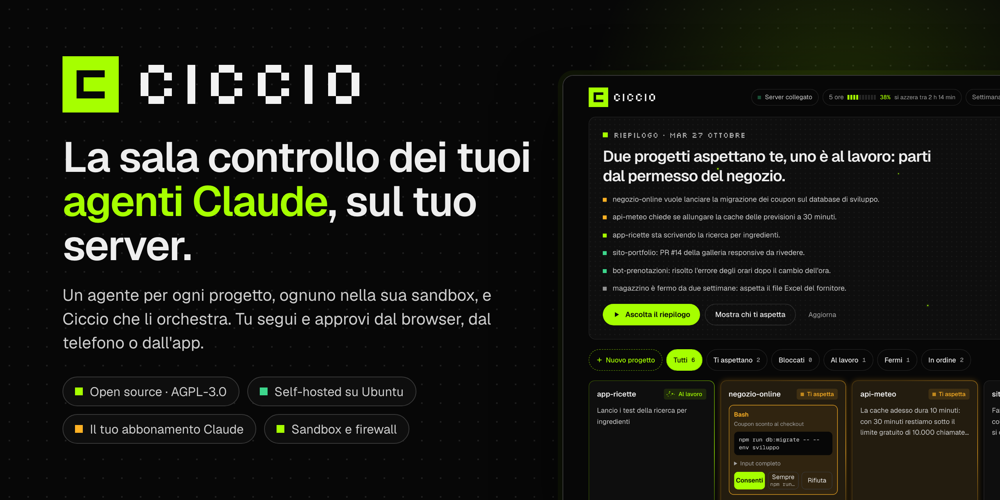
</p>

<p align="center">
  <a href="https://github.com/danielecosta7/ciccio/actions/workflows/ci.yml"></a>
  <a href="https://github.com/danielecosta7/ciccio/releases/latest"></a>
  <a href="LICENSE"></a>
  
</p>

<p align="center">
  <a href="https://danielecosta7.github.io/ciccio/">Sito</a> ·
  <a href="#installazione">Installazione</a> ·
  <a href="#domande-frequenti">Domande frequenti</a> ·
  <a href="docs/installazione.md">Guida completa</a>
</p>

**Ciccio** è una sala controllo open source per gli agenti di [Claude Code](https://code.claude.com). Lo installi sul tuo server: ogni progetto (un repo git) ha il suo agente, che lavora chiuso in una sandbox. E sopra gli agenti c'è **Ciccio, un vero orchestratore**: gli chiedi un lavoro che tocca più progetti e lui lo divide, scrive a ogni agente, aspetta le risposte, passa i risultati da uno all'altro e alla fine ti dice com'è andata. Tu segui tutto in una griglia e approvi quello che conta dal browser, dal telefono o dall'app desktop.

Usa il tuo abbonamento Claude (Pro, Max, Team o Enterprise), non una chiave API. L'interfaccia è in italiano.

> Ciccio è un progetto indipendente: non è un prodotto di Anthropic.

<p align="center">
  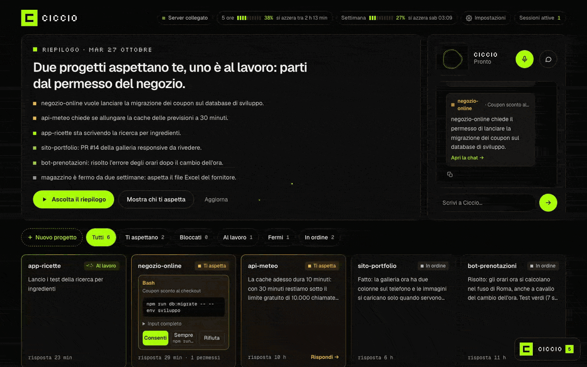
  <br><sub>Un agente chiede il permesso di lanciare una migrazione: lo apri dalla griglia e lo consenti con un clic.</sub>
</p>

## Cosa fa

<p align="center">
  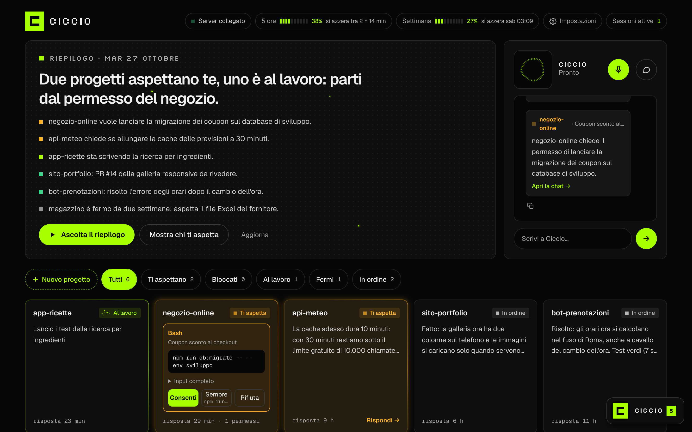
</p>

<table>
  <tr>
    <td width="50%">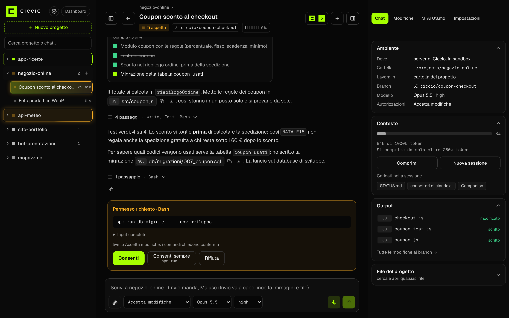<br><sub><b>La chat di un agente</b>: passaggi, file toccati e il permesso da dare.</sub></td>
    <td width="50%">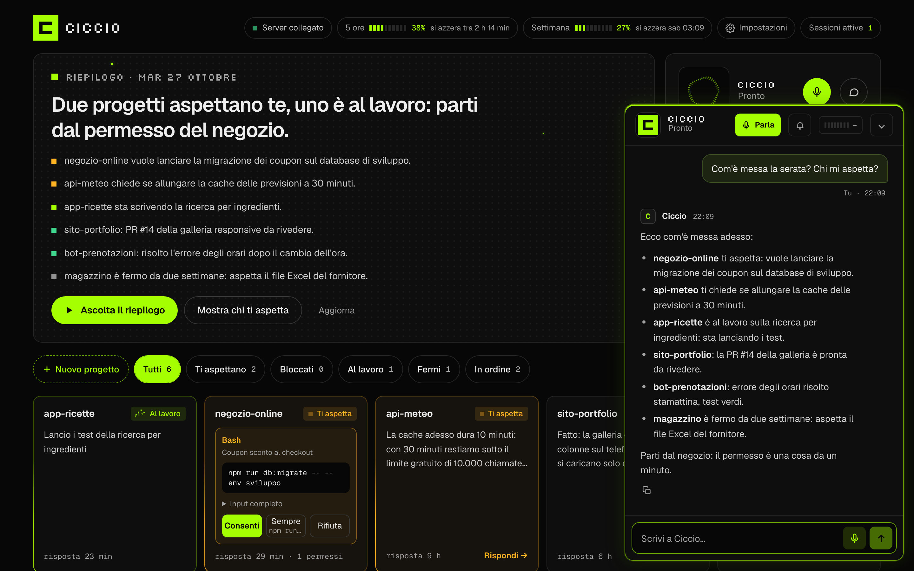<br><sub><b>Ciccio</b>, l'orchestratore: ti dice chi ti aspetta e da dove partire.</sub></td>
  </tr>
  <tr>
    <td width="50%">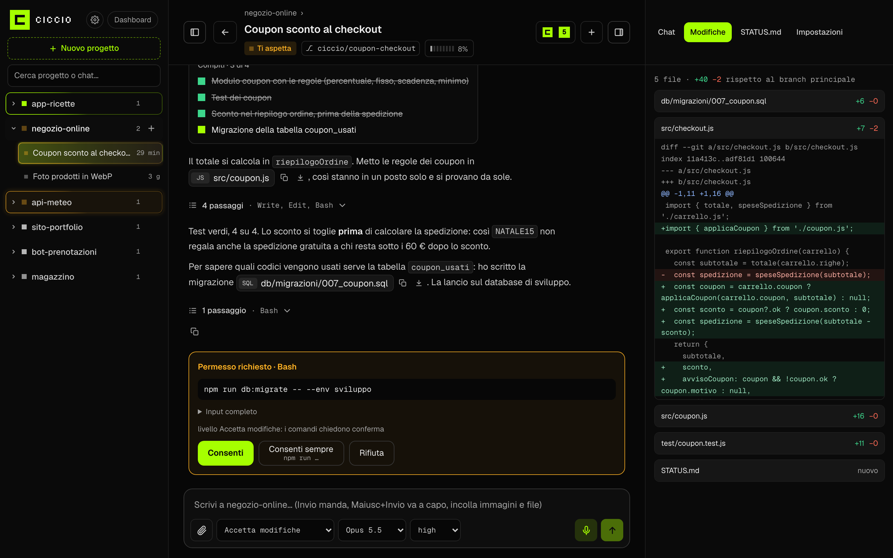<br><sub><b>Le modifiche</b> del branch, file per file.</sub></td>
    <td width="50%">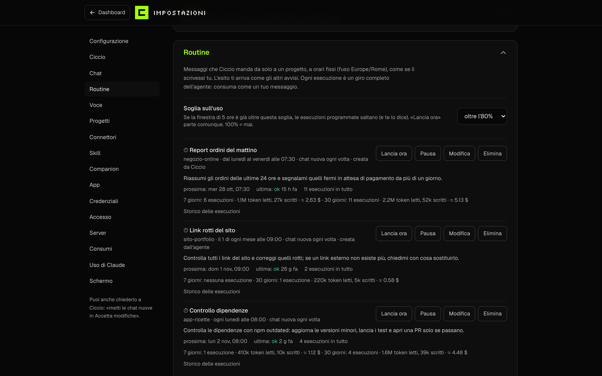<br><sub><b>Le routine</b>: messaggi a orari fissi, con l'esito di ogni esecuzione.</sub></td>
  </tr>
</table>

<p align="center">
  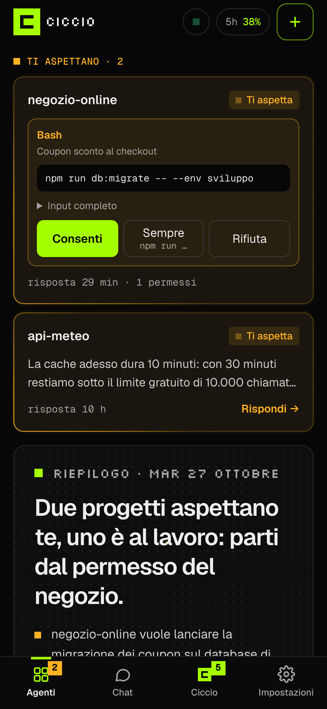
  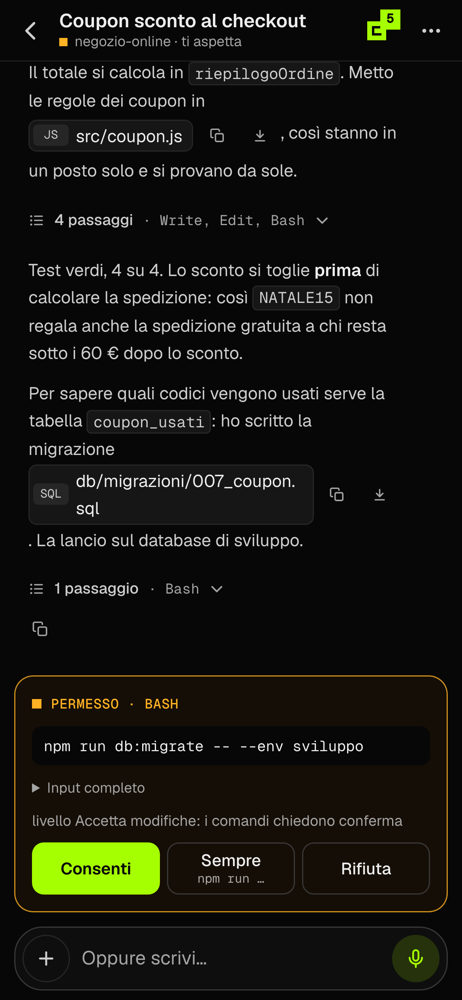
  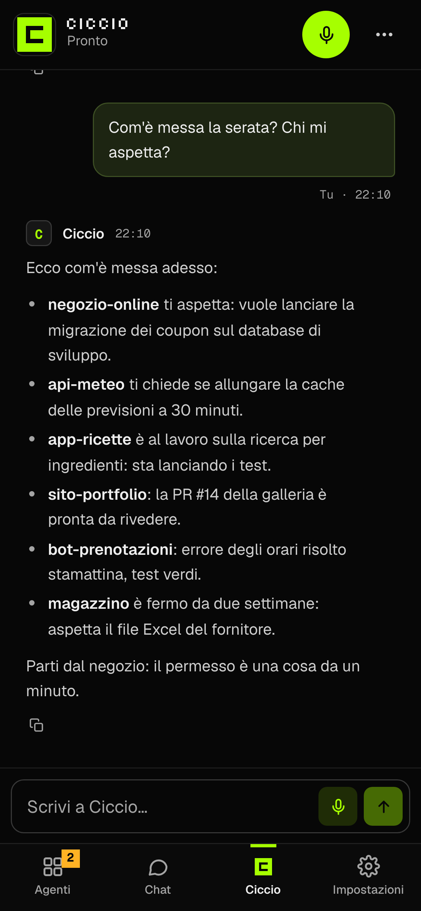
  <br><sub>Sul telefono si installa come un'app, con notifiche e voce.</sub>
</p>

- **Un agente per ogni progetto.** Ogni repo ha il suo agente, con le sue chat, i diff, i file e la stessa potenza di Claude Code.
- **Ciccio orchestra.** Coordina gli agenti al posto tuo: passa il lavoro da un progetto all'altro, crea progetti e chat, ti fa il riepilogo del mattino. [Come funziona ↓](#ciccio-lorchestratore)
- **Prima chi aspetta te.** La griglia mostra chi lavora, chi è fermo e chi ti aspetta. Le richieste di permesso arrivano come card, anche nelle notifiche: Consenti o Rifiuta con un tocco.
- **Dal telefono come dal PC.** Si installa sul telefono come un'app, con notifiche e voce; c'è anche l'app desktop per Mac e Windows.
- **Routine.** Messaggi che partono da soli a orari fissi: «ogni lunedì alle 8 fai il punto delle PR».
- **I tuoi PC al servizio degli agenti.** Con il companion (Mac e Windows) un agente può usare i programmi del PC acceso, i file e le chiavi di 1Password, sempre dopo il tuo ok.

## Ciccio, l'orchestratore

<p align="center">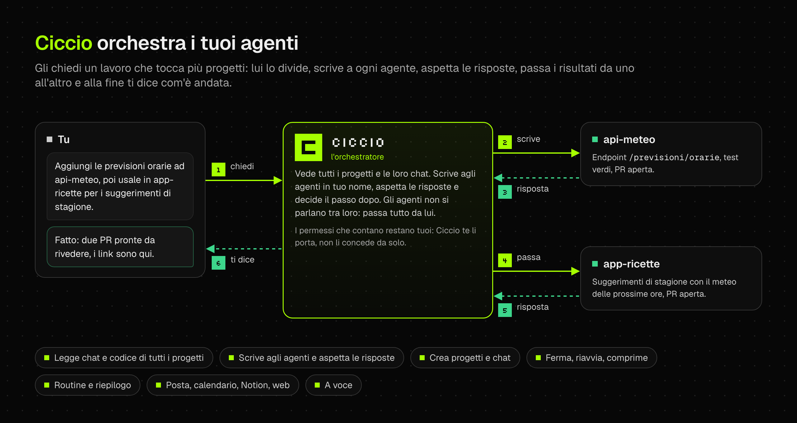</p>

<p align="center">
  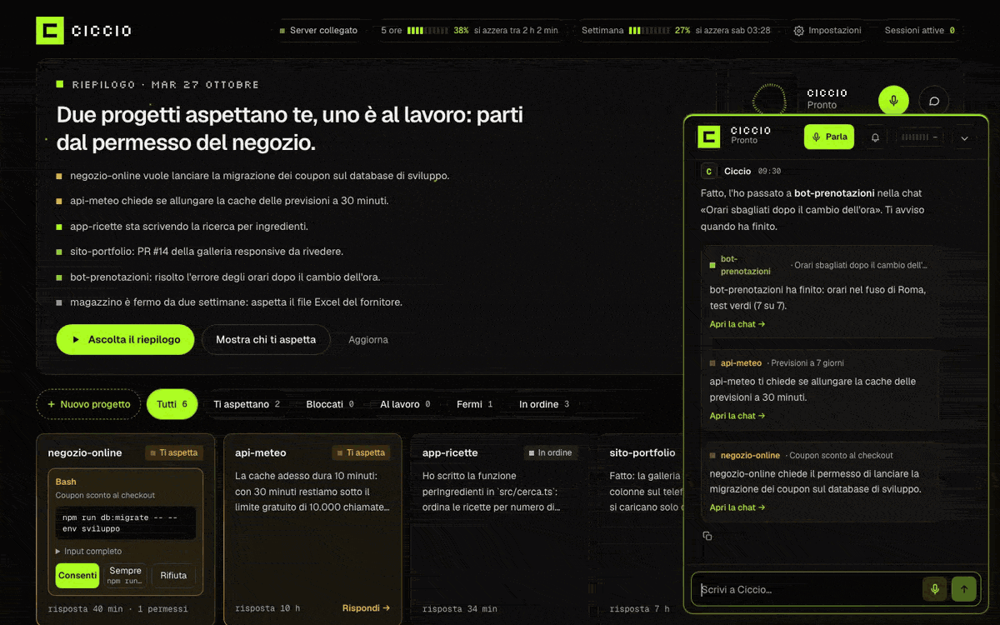
  <br><sub>Chiedi una cosa a Ciccio: la passa ad api-meteo, aspetta la risposta, gira il lavoro ad app-ricette e ti riporta le due PR.</sub>
</p>

Ciccio non è solo una chat in più: è un agente Claude con i suoi strumenti, che lavora **sopra** gli agenti dei progetti.

- **Vede tutto.** Lo stato di ogni agente, le novità, le loro chat e il loro `STATUS.md`; legge il codice di tutti i progetti.
- **Scrive agli agenti in tuo nome**, nella chat in corso, in una precisa o in una nuova, con un'istruzione chiara e completa.
- **Aspetta e concatena.** Quando un agente finisce, la risposta torna a Ciccio, che decide il passo dopo: passare il lavoro a un altro progetto, rispondere all'agente o dirti il risultato in una frase.
- **Gli agenti chiedono a lui.** Le chat non si parlano tra loro: se a un agente serve qualcosa da un altro progetto, scrive a Ciccio, che coordina.
- **Gestisce il lavoro.** Crea progetti nuovi (repo su GitHub, clone e prima chat), apre, ferma e comprime le chat, cambia modello e livello, imposta le routine.
- **Usa i tuoi strumenti.** Connettori del tuo account claude.ai (posta, calendario, Notion…), ricerca sul web, e ci parli anche a voce.

I permessi che contano restano tuoi: Ciccio te li porta, ma per consentire serve sempre il tuo ok.

## Come funziona

<p align="center">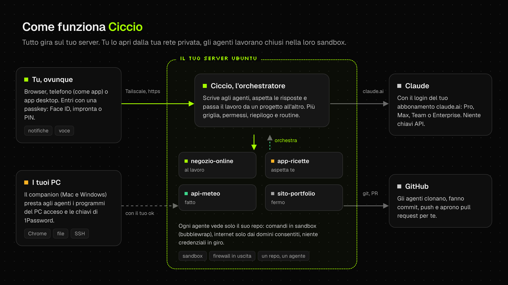</p>

Tutto gira sul tuo server: codice, chat e dati restano lì. Ciccio non è esposto su internet, ci arrivi dalla tua rete privata [Tailscale](https://tailscale.com) ed entri con una passkey (Face ID, impronta o PIN).

## Sicuro e provato

Ciccio fa eseguire comandi a degli agenti sul tuo server. Per questo la sicurezza non è un'opzione:

- **Un agente, un repo.** I comandi girano in una sandbox (bubblewrap): l'agente scrive solo nel suo progetto e non vede gli altri, le credenziali di Claude, le chiavi SSH o la configurazione del server.
- **Internet solo dove serve.** Un firewall in uscita lascia passare solo i domini consentiti (Anthropic, GitHub, npm…); quelli nuovi li approvi tu.
- **Il permesso lo dai tu.** Scegli per ogni chat quanto lasciar fare da solo all'agente; le azioni che contano diventano una card da approvare.
- **Aggiornamenti firmati.** Companion e app desktop installano solo release firmate (Ed25519) dalle GitHub Actions.
- **Provato davvero.** CI a ogni modifica; installazione rifatta da zero su un server Ubuntu vuoto e rilanciata due volte senza rifare niente; sandbox verificata con un agente al lavoro; Ciccio gira ogni giorno in produzione.

Dettagli e limiti noti: [docs/sicurezza.md](docs/sicurezza.md) e [SECURITY.md](SECURITY.md).

## Cosa serve

| | |
| - | - |
| **Un server** | Ubuntu 24.04 vuoto, anche un VPS da pochi euro: 2 CPU e 4 GB di RAM bastano per qualche agente alla volta (x86_64 o arm64), con accesso root. |
| **Un abbonamento Claude** | Uno qualsiasi a pagamento: Pro, Max, Team o Enterprise. Il piano gratuito non basta: non include Claude Code. |
| **Tailscale** | Un account gratuito, e l'app sul telefono e sul PC da cui apri Ciccio. |
| **GitHub** (facoltativo) | Se vuoi che gli agenti clonino, facciano push e aprano pull request. |

Al resto (Node, git, sandbox, firewall) pensa l'installazione.

## Installazione

Sul server, come root. Ci vuole una ventina di minuti:

```bash
apt-get install -y git
git clone https://github.com/danielecosta7/ciccio ciccio-setup
bash ciccio-setup/deploy/setup.sh
```

`setup.sh` è una procedura guidata. Per ogni passo ti dice cosa sta per fare e chiede conferma; Invio accetta la risposta proposta. Se la interrompi, la rilanci e riparte da dove eri. Durante l'installazione:

1. **Tailscale** stampa un link: lo apri, accedi e il server entra nella tua rete privata.
2. **GitHub** ti mostra un codice da inserire su github.com (puoi saltarlo).
3. **Claude** stampa un link: accedi con il tuo account Claude e incolli il codice che ti mostra.
4. Alla fine ti dà un **codice di attivazione**.

Poi, da un dispositivo con Tailscale, apri l'indirizzo che ti ha indicato (tipo `https://ciccio.tuarete.ts.net`), inserisci il codice e crei la tua passkey. Per aggiungere un progetto clona il suo repo nella cartella dei progetti, oppure crealo da Ciccio: diventa subito un agente.

Per aggiornare, come l'utente di Ciccio: `cd ~/ciccio && bash deploy/install.sh`. Aspetta che gli agenti finiscano quello che stanno facendo, poi si riavvia.

Tutti i passi, l'installazione a mano e i casi particolari: [docs/installazione.md](docs/installazione.md).

## Companion e app desktop

Due programmi facoltativi per Mac (Apple Silicon) e Windows, che trovi nelle [release](https://github.com/danielecosta7/ciccio/releases/latest) e in Ciccio stesso (Impostazioni):

<p align="center">
  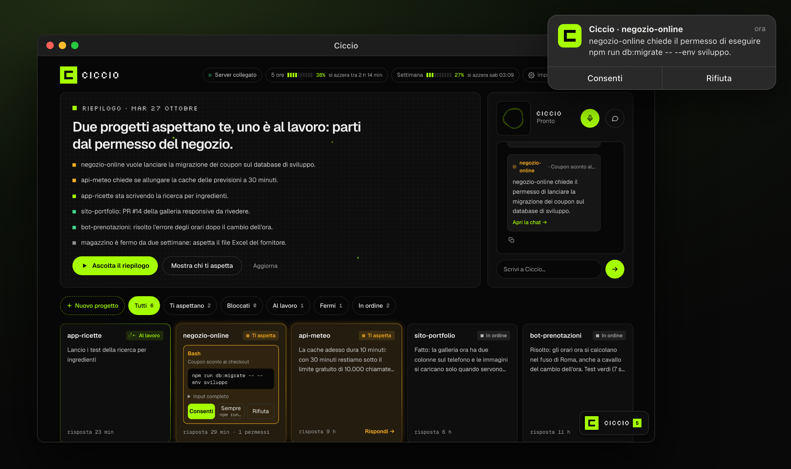
  <br><sub>L'app desktop: la notifica di un permesso si decide senza aprire la finestra.</sub>
</p>
<p align="center">
  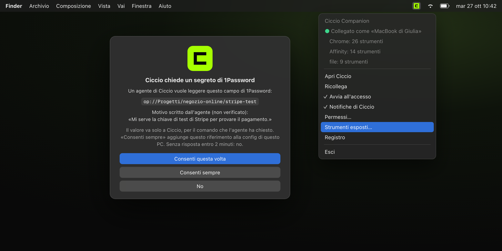
  <br><sub>Il companion: un agente chiede un segreto di 1Password e decidi tu, sul PC.</sub>
</p>

- **App desktop.** Ciccio in una finestra sua, con le notifiche del sistema e Consenti/Rifiuta direttamente dalla notifica.
- **Companion.** Gli agenti usano i programmi del tuo PC acceso (Chrome, file, comandi, 1Password), sempre con una conferma sul PC.

Si collegano a Ciccio con un codice e si aggiornano da soli, solo con release firmate.

## Domande frequenti

**Serve una chiave API di Anthropic?**
No, e non va usata. Ciccio funziona con il login del tuo abbonamento claude.ai, come Claude Code sul tuo PC. Fa lavorare gli agenti in modalità agentica: chat lunghe che tengono il contesto da un giro all'altro, con i connettori e le skill del tuo account. È costruito e provato così: con una chiave API il contesto si perderebbe e niente è stato provato. Se sul server c'è una chiave API, Ciccio non la passa agli agenti.

**Quanto costa?**
Ciccio è gratis e open source. Paghi il tuo abbonamento Claude (i limiti di utilizzo sono quelli del tuo piano, condivisi da tutti gli agenti) e il server.

**Che differenza c'è con Claude Code?**
Gli agenti sono Claude Code. Ciccio ci aggiunge quello che serve per farne lavorare tanti insieme: un orchestratore che li coordina, un server sempre acceso, un agente per progetto, la sandbox, i permessi dal telefono, le notifiche, il riepilogo, le routine.

**I miei dati dove vanno?**
Restano sul tuo server. Le richieste ai modelli vanno ad Anthropic con il tuo account, come con Claude Code. L'elenco completo delle connessioni esterne è in [docs/sicurezza.md](docs/sicurezza.md#connessioni-esterne).

**Funziona senza server, sul mio PC?**
No: Ciccio è pensato per un server Linux sempre acceso, così gli agenti lavorano anche quando il PC è spento.

**Posso usarlo da fuori casa?**
Sì, dal telefono o dal PC con Tailscale acceso, da qualunque rete. Se vuoi puoi aggiungere anche un tuo dominio.

**È in inglese?**
Per ora interfaccia e documentazione sono in italiano.

## Documentazione

- [Installazione e aggiornamenti](docs/installazione.md)
- [Configurazione](docs/configurazione.md)
- [Sicurezza e connessioni esterne](docs/sicurezza.md)
- [Com'è fatto dentro](docs/tecnico.md)
- [Sviluppo](docs/sviluppo.md) e [come contribuire](CONTRIBUTING.md)

**Non tutto è open source.** Ciccio funziona con il [Claude Agent SDK](https://code.claude.com/docs/en/agent-sdk) e con Claude Code, software proprietario di Anthropic con le sue [condizioni](https://www.anthropic.com/legal/commercial-terms), che non sono coperti dalla licenza di Ciccio. Dettagli in [THIRD_PARTY_NOTICES.md](THIRD_PARTY_NOTICES.md).

## Licenza

© 2026 Daniele Costa. Ciccio è software libero con licenza [AGPL-3.0-only](LICENSE): puoi usarlo, studiarlo, modificarlo e ridistribuirlo alle sue condizioni. Se offri ad altri Ciccio modificato come servizio, devi rendere disponibile anche il tuo codice (vedi `CICCIO_SOURCE_URL` in [docs/configurazione.md](docs/configurazione.md)).
